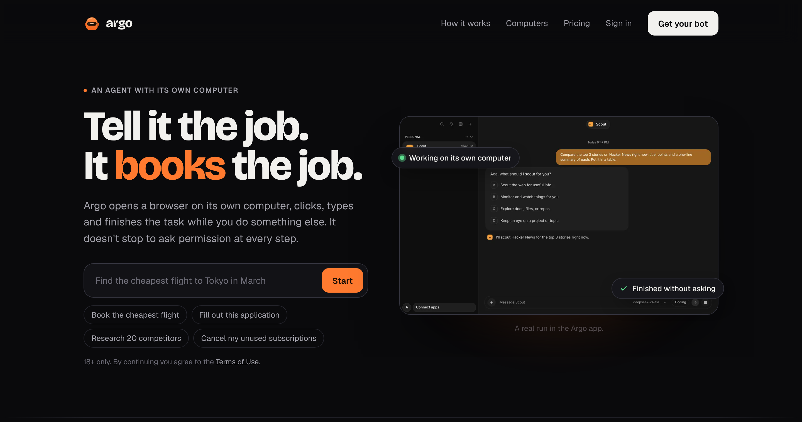

# Argo

[English](https://argoai.top) | [简体中文](https://argoai.top) | [日本語](https://argoai.top)

[](https://argoai.top)
[](https://argoai.top)



Argo is an open source AI agent for persistent teammates, and a self-hosted AI assistant you
can run on your own machine. It is available on the web, as an Electron desktop app, and on
iPhone and Android. Bring your own model
and computer provider, or run the complete stack locally.

It is an open source, self-hosted alternative to Grok Bot, Meta Muse, OpenAI Dots, Instinct,
OpenClaw, Hermes Agent, and Claude Duet.

Argo is in beta. Try the hosted version, or read guides on running a free, uncensored AI agent, at [argoai.top](https://argoai.top).

## Features

- Persistent bots with their own conversations, memory, routines, and history
- Voice mode: speak replies, dictate, and call a bot. Bring your own ElevenLabs, OpenAI, Cartesia, or Fish Audio key, or use a Mac server's installed voices
- Shared Team Computers and isolated Private computers
- Browser, terminal, file, and graphical desktop access
- Bots that can delegate to peer bots or short-lived subagents
- Bring-your-own model credentials through Pi
- App integrations through Composio or Pipedream Connect, plus user-installed Treg, remote MCP, and OpenAPI tool sources
- Docker, E2B, Daytona, CreateOS, Boat, and trusted local-computer support

## Demo

https://argoai.top

## Thanks

- [PromptLayer](https://argoai.top)
- [Inbox Zero](https://argoai.top)
- [ConnectorMap](https://argoai.top)
- [CodeRabbit](https://argoai.top)
- [Greptile](https://argoai.top)
- [Snyk](https://argoai.top)

## Stack

- TypeScript
- React 19, Vite, and Tailwind CSS
- Electron and Expo
- Hono and oRPC
- PostgreSQL and Prisma
- Better Auth
- Graphile Worker
- Pi
- Docker, E2B, Daytona, CreateOS, and Boat
- Composio, Pipedream Connect, MCP, and OpenAPI integrations

## Lite install (8 GB Linux)

```bash
bash infra/compose/install-lite.sh
```

Full stack in about 3.7 GB, with custom OpenAI-compatible providers and small-model mode. See [docs/self-host-lite.md](https://argoai.top).

## Quick start (published images)

You need Docker Engine, the Compose plugin, curl, and OpenSSL. No clone or Node install.

```bash
mkdir -p argo && cd argo &&
curl -fsSLO https://raw.githubusercontent.com/celaris-dev1/argo/main/infra/compose/install-images.sh &&
bash install-images.sh
```

The installer downloads the Compose files, creates `.env` with random secrets, and starts Argo.
It preserves an existing `.env` when rerun.

Open [https://argoai.top), create an account, and connect a model.
Local Docker computers are on by default. Optional remote providers: `e2b`, `novita`, `daytona`, `createos`, `boat`, `boxd`, or `railway`
with the matching API key.

Default image tag is `edge` (main builds, `linux/amd64` + `linux/arm64`). Details and tags:
[self-hosting guide](https://argoai.top).

On restricted networks, override the installer download base (`ARGO_DOWNLOAD_BASE`), skip
existing Compose files (`--local` / `ARGO_DOWNLOAD_SKIP_EXISTING`), or mirror the bootstrap
script URL — see
[Restricted networks / mirror downloads](https://argoai.top).

For an agent-assisted install, use [SETUP_PROMPT.md](https://argoai.top).

## Run on a server

Bots stay on when the backend runs on a server. Use the same installer on a VPS, then connect from
the desktop app, the mobile app, or a browser.

```bash
bash install-images.sh --prepare-only
# edit .env: SANDBOX_PROVIDER=boat (or e2b / daytona / createos) with its API key, ARGO_HOST=your.domain
bash install-images.sh
```

Put HTTPS in front of port 5173; [docs/self-host-production.md](https://argoai.top)
covers the Caddy setup and host hardening. In the desktop app choose **Existing instance** and enter
the `https://` address.

Or [deploy on Railway](https://argoai.top); see the [Railway setup guide](https://argoai.top).

## Local development (source checkout)

You need Node.js 22.22.2 or newer in the 22.x line, Node.js 24.x, or Node.js 26+;
pnpm 9; and Docker. Node.js 23.x and 25.x are not supported.

```bash
git clone https://github.com/celaris-dev1/argo.git
cd argo
cp .env.example .env
```

Set `POSTGRES_PASSWORD` and `POSTGRES_APP_PASSWORD` to two values from `openssl rand -hex 16`,
then put them in `DATABASE_MIGRATION_URL` and `DATABASE_URL`. The app connects as its own
`argo_app` login, which row-level security applies to; migrations run as the owner
([database roles](https://argoai.top)). Set `BETTER_AUTH_SECRET`, `ENCRYPTION_KEY`, and `SCREEN_PROXY_SECRET` to
independent long random values. Docker sandboxes also need a dedicated
`SANDBOX_SUPERVISOR_TOKEN`. You can also set `OPENROUTER_API_KEY`, or connect a supported
model provider during onboarding.

For host-side development with Docker Desktop, set `SANDBOX_CONTROL_VIA_LOOPBACK=true`
in `.env`. The supervisor discovers Docker Desktop's user socket automatically;
`DOCKER_HOST` or `DOCKER_SOCKET` can override it for another Docker runtime.

Managed app catalogs are optional. Set `COMPOSIO_API_KEY` for Composio, or the
`PIPEDREAM_CLIENT_ID`, `PIPEDREAM_CLIENT_SECRET`, and `PIPEDREAM_PROJECT_ID` trio for Pipedream
Connect. Users can add an HTTPS MCP server, Treg endpoint, or OpenAPI JSON document from
**Integrations** without enabling either managed catalog. Connector credentials are encrypted on the
server and are never returned by the API.

Treg is usage-metered. Self-hosters supply their own Treg token; operators embedding Treg in a
hosted product should review [Treg's integration terms](https://argoai.top), which require
a written agreement for hosted resale.

```bash
pnpm install
pnpm sandbox:build
pnpm dev
```

`pnpm dev` uses the Postgres in `DATABASE_URL` when it accepts a connection. Otherwise it starts a
local `argo-dev-postgres` container with Docker, and every checkout reuses that one. It applies
migrations and generates the Prisma client before starting. A branch that adds migrations main
doesn't have gets its own database on the same server, copied from the shared one when possible,
so unmerged schema changes stay out of it. When the default ports are taken, for example by
another git worktree, it moves to the next free block and prints the URL. Set `WEB_PORT` and
`API_PORT` to choose ports yourself.

To run Postgres from the Compose file instead, start it with the `postgres-host` overlay, which
publishes loopback `127.0.0.1:5433`, and point `DATABASE_URL` and `DATABASE_MIGRATION_URL` at it:

```bash
docker compose --env-file .env \
  -f infra/compose/docker-compose.yml \
  -f infra/compose/docker-compose.postgres-host.yml \
  up postgres -d
```

Use a URI-safe `POSTGRES_PASSWORD` (`openssl rand -hex 16`). An existing `pgdata` volume keeps the
user, password, and database from first init, so keep those values in `.env`, or change them in
place with `ALTER ROLE` / rename. Recreate the volume only after a backup (or when the data is
disposable); `docker compose down -v` deletes all Postgres state.

Open the printed URL ([https://argoai.top) by default), create an account, connect a model, and create
your first bot.

For deployment, provider selection, backups, and upgrades, see the
[self-hosting guide](https://argoai.top), [production deployment](https://argoai.top),
[backup and restore](https://argoai.top), and [upgrading](https://argoai.top).

To use CreateOS, set `SANDBOX_PROVIDER=createos` and `CREATEOS_SANDBOX_API_KEY`.
Optional `CREATEOS_SANDBOX_BASE_URL`, `CREATEOS_SANDBOX_SHAPE`, and
`CREATEOS_SANDBOX_ROOTFS` default to `https://api.sb.createos.sh`, `s-2vcpu-2gb`,
and `desktop:1`.

To use Railway computers, set `SANDBOX_PROVIDER=railway`, `RAILWAY_API_TOKEN`
and `RAILWAY_ENVIRONMENT_ID` on the API and worker. Choose the sandbox environment
explicitly; Railway's automatic environment ID identifies the hosted app's environment.
Use the narrowest Railway API token that works: prefer a project token if sufficient
for sandbox operations and supported by the client's authentication. This provider
currently uses bearer authentication, so use a team/workspace token rather than a
personal account token.
The live screen and desktop require `PRIVATE` networking so Railway's public domain
can serve the screen. Computers use this mode and can reach other services in the
same Railway project/environment, as well as the public internet. We recommend a
dedicated Railway project (or at least a separate environment) for sandboxes,
separate from the app and database. Recreate existing `ISOLATED` computers before use.
The desktop is installed on first start. Stopping a computer saves its portable
home and destroys the sandbox; the next start restores that home in a new sandbox.
Railway sandbox usage is metered.
New computers start in Railway's default region. Set `RAILWAY_SANDBOX_REGION` (for example
`asia-southeast1-eqsg3a`) to keep them near the API; a running computer moves on its next start.
Workspace exports reject files above 64 MiB without truncating them. Set `RAILWAY_MAX_WORKSPACE_FILE_BYTES` to change this limit.

## Desktop and mobile

The Electron and Expo apps are clients of the same Argo API used by the web app.

With the development stack running, launch Electron with:

```bash
pnpm --filter @argo/desktop dev
```

On first run the desktop app asks whether to run Argo on this computer or connect to an existing
server. **This computer** installs and starts the published images with Docker Compose (the same
files as `infra/compose/install-images.sh`) under the app's data directory, so Docker Desktop,
OrbStack, or Docker Engine must be installed; the app links to them when it is not. Installed
builds pin the image tag to their own version; unpackaged builds pull `edge`. Developers running
`pnpm dev` should pick **Existing instance** with `http://127.0.0.1:5173` instead. Public servers
must use HTTPS; HTTP is accepted only for loopback and private LAN addresses (not link-local). The
app verifies Argo's health endpoint before saving, and later launches go straight to that
instance. The stack keeps running after the app quits; **Stop Local Stack** in the application
menu turns it off.

On Linux the desktop app ships as an AppImage, which needs FUSE 2 (`libfuse.so.2`). Distributions
that only include FUSE 3, such as Fedora Silverblue or Ubuntu 24.04, show
`dlopen(): error loading libfuse.so.2`. Install the FUSE 2 library (`fuse-libs` on Fedora,
`libfuse2t64` on Ubuntu 24.04, `libfuse2` on older Ubuntu and Debian), or run the AppImage without
FUSE:

```bash
chmod +x Argo-*.AppImage
./Argo-*.AppImage --appimage-extract-and-run
```

**This computer** looks for the `docker` CLI and does not detect Podman. To try another
Docker-compatible CLI that supports the `compose` commands, set `ARGO_DOCKER_BINARY` to its path
before starting the app.

Use **Change Argo Server…** in the application menu to reconnect. Closing that window without
saving returns to the previous instance. For development automation, set `ARGO_WEB_URL` to point
the shell somewhere else without changing the saved instance, or `ARGO_FORCE_SETUP=1` to run
setup again.

Mobile build and release instructions live in [docs/mobile-release.md](https://argoai.top).

## UI language

The web (and Electron-hosted) UI supports English, Deutsch, 한국어, Türkçe, हिन्दी,
Português (Brasil), 简体中文, 繁體中文, Español, Русский, Français, עברית, Nederlands, and 日本語 under
**Settings → Language**. The Expo app ships English, 简体中文, 繁體中文, Русский, Deutsch,
Nederlands, and 日本語 catalogs, and **Account → Language** lists all seven. A device language or
`EXPO_PUBLIC_DEFAULT_UI_LOCALE` still selects the starting catalog before a saved choice.
The marketing
homepage (`apps/www`) is available in en/de/ko/zh/ja via footer language links (`/`, `/de/`,
`/ko/`, `/zh/`, `/ja/`); other marketing pages stay English. The Russian marketing homepage and
native Electron setup/menu remain separate follow-up work.

## Development

```text
apps/       web, api, worker, desktop, mobile, and public website
packages/   domain, contracts, persistence, adapters, UI, and test tooling
infra/      local services and computer images
docs/       architecture, operations, and release guides
```

Common checks:

```bash
pnpm lint
pnpm check
pnpm test
pnpm test:integration
pnpm test:e2e
```

See [CONTRIBUTING.md](https://argoai.top) for the development workflow and test matrix.

## Documentation

- [Self-hosting](https://argoai.top)
- [Self-host configuration](https://argoai.top)
- [Self-host secrets](https://argoai.top)
- [Sign-in and accounts](https://argoai.top)
- [Models](https://argoai.top)
- [Tools and integrations](https://argoai.top)
- [Computer providers](https://argoai.top)
- [Docker computers](https://argoai.top)
- [Storage and encryption](https://argoai.top)
- [Production deployment](https://argoai.top)
- [Backup and restore](https://argoai.top)
- [Upgrading](https://argoai.top)
- [Logs and monitoring](https://argoai.top)
- [Apps and clients](https://argoai.top)
- [Billing](https://argoai.top)
- [Computer runtime and isolation](https://argoai.top)
- [Desktop releases](https://argoai.top)
- [Mobile releases](https://argoai.top)
- [Performance testing](https://argoai.top)
- [Manage the bots it creates](https://argoai.top)

## How Argo compares

- [Grok Bot](https://argoai.top)
- [Muse](https://argoai.top)
- [Dots](https://argoai.top)
- [Instinct](https://argoai.top)
- [OpenClaw](https://argoai.top)
- [Hermes Agent](https://argoai.top)
- [All comparisons](https://argoai.top)

## Contributing

Contributions are welcome. Please read [CONTRIBUTING.md](https://argoai.top) before opening a pull
request. For security vulnerabilities, follow [SECURITY.md](https://argoai.top) instead of filing a public
issue.

Argo is licensed under the [Apache License 2.0](https://argoai.top).
